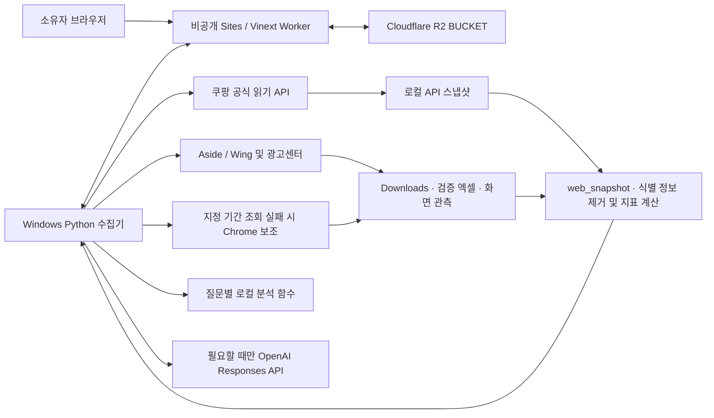

# 왓니몰 쿠팡윙 자동화 대시보드 · Antigravity 인수인계

기준: 2026-11-09 KST. 현재 작업공간의 실행 코드와 설정을 기준으로 작성했다. 아래의 **현재 동작**과 **개선 작업**을 구분해서 읽는다. 과거 `README.md`의 수집 건수, 소요 시간과 AI 검증 설명은 당시 기록이다.

운영 주소: [왓니몰 Rocket Desk](https://rocket-desk-watnimall.mindery1.chatgpt.site/). 운영 웹은 소유자 전용이며, 웹 저장소 기준 리비전은 `4515f8a07d90df1c85dd821e3dc77d08f6247259`다. 이 리비전은 `web/`에만 해당한다. **최신 수집·대화 로직은 루트의 `src/`에도 있으므로, Antigravity에서 프로젝트 루트 전체를 열어야 한다.**

## Antigravity에 전달할 작업 지시

> 이 Markdown과 프로젝트 루트 전체를 읽고, 운영 대시보드의 프런트엔드·Worker·Python 수집기·대화 엔진을 함께 검수해 줘. 먼저 소스와 테스트를 대조해서 아래 현행 설명 중 달라진 점을 표시하고, 비식별 테스트 데이터로 기준 결과와 응답 시간을 확보해. 같은 데이터로 개선 전후를 비교할 수 있게 해 줘.
>
> 가장 중요한 요구는 사용자가 **기존 왓니몰 대화창**에 자연어로 묻고, 판매·가격·재고·입고·반출·광고·반품·수익성에 대해 결론과 근거를 한 번에 받는 것이다. 질문 예문만 외우는 방식은 피하고, 질문의 대상·기간·목표·복합 의도를 찾아 검증된 조회 및 계산 함수를 조합해. 숫자와 상품 매칭은 원본에서 검증하고, 결측이나 오래된 자료가 있으면 확인된 부분의 답과 필요한 자료를 함께 제시해.
>
> 개선 결과는 로컬 테스트와 재현 가능한 검수표로 남겨 줘. 운영 계정 접근 범위, 실제 쿠팡 상태를 바꾸는 기능, 과금 모델 변경 및 운영 배포는 검수 결과와 분리해서 검토할 수 있게 해 줘. 비밀값과 고객 식별 정보는 문서나 모델 입력에 넣지 마.

## 1. 구성과 데이터 흐름



- **운영 웹**은 React 19·TypeScript·Vinext다. `web/worker/index.ts`가 `/api/desk`를 처리하고 나머지 요청을 Vinext로 전달한다. `web/.openai/hosting.json`은 `r2: "BUCKET"`, `d1: null`이다. `web/db/`, Drizzle, 일부 커넥터 코드는 스타터에서 남은 구성이다. 현재 업무 데이터의 주 저장소는 R2다.
- **수집기**는 Windows의 `src/web_sync.py`다. 공식 API와 실제 로그인된 브라우저를 조회하고, 수집 자료를 검증해 웹에 게시한다. 비공개 웹은 수집 PC가 꺼져도 마지막 게시 자료를 보여준다. 새 수집과 새 대화 답변에는 수집기 연결이 필요하다.
- **로컬 Streamlit**은 루트 `app.py`다. `대시보드_실행.cmd` / `start.ps1`과 `127.0.0.1:8501`을 사용한다. 로컬 원본·원가·Chrome 페어링을 다루는 도구이기도 하다. 운영 웹의 페이지·대화 UI는 `web/app/`에 있다.
- **원본과 웹 요약**을 구분한다. 로컬 `raw_data/`의 검증 파일은 SHA-256으로 중복 업로드를 피하며, 원본은 비공개 자료실에서 내려받을 수 있다. `src/web_snapshot.py`는 화면과 에이전트에 쓸 필드를 투영한다. 원본 파일과 주문·고객 식별자가 포함된 로컬 API 자료는 모델 입력으로 보내지 않는다. 사용자가 대화에 직접 넣는 민감정보는 별도로 방지·검수할 필요가 있다.
- **Git 경계**를 먼저 확인한다. `web/`는 자체 `.git`과 운영 배포 원격을 가진 체크아웃이다. 바깥 저장소에서 `src/`, `tests/`, `docs/` 등이 추적되지 않는 상태를 확인했다. 백엔드 수정 이력과 소스 전달을 `git -C web`만으로 관리할 수 없다. 비밀값을 제외한 루트 소스의 버전 관리부터 정리한다.

## 2. 프런트엔드 지도

표의 `app/`와 `lib/`는 `web/` 아래 경로다. `src/`는 프로젝트 루트 아래다.

| 화면·기능 | 구현 위치 | 검수 포인트 |
|---|---|---|
| 앱 구성, 메뉴, 요약 지표, 표, 연결 상태 | `web/app/page.tsx`, `layout.tsx`, `globals.css`, `lib/desk-connection.ts` | 운영 한눈에, 상품·재고, 매출·정산, 반품, AI 코치, 매뉴얼, 자료실. 최초 로딩, 실패·빈 자료·부분 갱신, 모바일 메뉴와 가로 스크롤 확인 |
| 돈의 흐름 및 기간 | `app/profit-overview.tsx`, `lib/wing-period.ts`, `lib/profit-data.ts`, `lib/cash-graphic.ts` | 최근 7일·지난 달·이번 달·직접 지정. KST 전일까지. 원본 기간 일치, 부호, 비용 중복, 0과 미확인 구분 |
| 상품명·옵션·근거 상세 | `app/product-name.tsx`, `app/metric-explorer.tsx`, `lib/product-families.ts`, `lib/metric-data.ts`, `lib/display-terms.ts` | 같은 상품명 표식과 옵션·등급별 구분. ID, 검색·정렬, 원본 및 기준 시각 표시 |
| 매입원가·수익성 및 업로드 | `app/product-cost-desk.tsx`, `lib/product-costs.ts`, `lib/cost-import.ts` | 옵션 ID+등급, CSV/엑셀 입력 미리보기, 0원과 빈값, 미매칭·중복·이전 자료에 묶인 입력 처리 |
| 운영 판단 및 검수 화면 | `app/decision-desk.tsx`, `app/overview-insights.tsx`, `app/screen-brief.tsx`, `lib/decision-data.ts`, `lib/screen-review.ts` | 중복 입고 위험, 판매 속도, 품절, 광고 손익 가정, 반품. 화면 판매 속도는 Wing의 7일/30일 **판매금액 일평균** 비교이며 채팅의 7일 대 직전 7일 **API 주문수량**과 범위가 다름 |
| 판매금액 비교 | `app/revenue-comparison.tsx`, `src/revenue_comparison.py` | 공통/불일치 옵션, API·엑셀 기간과 부호, 합계 대사. 차이를 취소·환불로 추정해 확정하지 않음 |
| 갱신, 자료실, 로그인 | `app/refresh-controls.tsx`, `app/chatgpt-auth.ts`, `lib/source-health.ts`, `page.tsx` | 마지막 성공 시각 유지, 작업 상태 및 단계, 자료별 누락, 로그인 401/권한 403과 복구 안내, 원본 다운로드 |
| 에이전트 대화 및 운영 메모 | `app/chat-coach.tsx`, `app/floating-coach.tsx`, `app/use-movable.ts`, `app/operation-memory.tsx` 및 CSS | 대화 상대는 왓니몰 전용 에이전트. 질문 재전송, 진행·실패, 출처 카드, 이전 질문, 운영 메모, 작은 화면과 접근성 |
| 운영 매뉴얼 | `app/manual.tsx`, `src/operating_manual.py` | 자료의 최신성, 정책 및 검토 절차를 지표와 연결 |

현재 대시보드의 기본 조회는 15초 간격이다. 대화창이 열린 동안 대화 목록은 2.5초 간격으로 갱신한다. 재고 표는 처음 20행을 표시하고 펼쳐 볼 수 있다. 속도 개선 시 대화 중·유휴 상태의 폴링을 구분하고, 화면에 필요한 필드를 나눠 읽는 것을 검토한다.

## 3. 백엔드와 작업 상태

모든 아래 경로의 접두사는 `/api/desk`다. `web/lib/desk-api.ts`와 `web/lib/desk-chat-api.ts`가 계약의 원본이다.

| 메서드·경로 | 기능·저장 위치 |
|---|---|
| `GET /api/desk` | `snapshot.json`, `agent.json`, 최근 작업, 사용자 표시 정보. R2 상품 원가 마스터와 기간별 손익 입력을 읽어 계산·병합 |
| `POST /refresh`, `GET /queue`, `PUT /job/:id` | `jobs/<id>`에 `quick`, `full`, `ai`, `profit-period` 작업 저장. `queued → running → complete / partial / failed`. 유효한 작업 중복과 서로 다른 기간 요청 충돌 처리 |
| `PUT /snapshot`, `PUT /agent` | 검증된 `schema: 1` 요약 및 연결 신호 게시. 스냅샷 요청 상한 약 5 MB |
| `GET/PUT /file/:sha256` | `files/<sha256>`의 원본 저장·다운로드. 최대 50 MB, 해시 대조, GET은 스냅샷 원본 목록에 등록된 파일만 허용 |
| `GET /profit-period?start=…&end=…` | 동일 시작일·종료일의 가장 최근 성공 Wing 관측과 해당 기간 손익 반환 |
| `POST /profit-costs` | `profit-costs-period/<시작>_<끝>.json` 저장 및 초기화. 구버전 `profit-costs.json`은 폴백이며 원본 `basis`가 달라지면 재확인 필요 |
| `POST /product-costs` | `product-costs.json`, `product-cost-history/`. 스냅샷 `basis` 및 `revision`을 검증하고 이전 마스터 이력을 저장 |
| `GET/POST /chat` | 최근 대화 표시와 질문 등록. `chat/turns/<id>`, `chat/requests/<request_id>`로 보관·중복 요청 대응 |
| `GET /chat/queue`, `PUT /chat/:id` | 수집기가 질문을 가져와 `running / complete / failed` 기록. 성공한 답변은 로컬 `data/chat_reply_<id>.json`에도 캐시 |
| `GET /chat/context/:id`, `GET/PUT /chat/memory` | 직전 대화 및 관련 이전 질문 조회, `chat/memory/<uuid>`에 수입 건 운영 메모 저장·수정·삭제 |

실행 흐름은 `src/web_sync.py`의 `Sync`를 따른다. 생산/로컬 단일 실행 잠금은 각각 루프백 18761/18762, 연결 신호는 25초 간격이다. 갱신 루프는 작업이 없는 때 15초 간격, 대화 루프는 3초 간격이다. 대화와 갱신은 별도 루프다. 웹 대화 등록은 수집기 신호 90초, 질문 만료 180초, 질문 2,000자, 분당 6건 제한을 둔다. 답변 갱신 JSON의 상한은 200,000바이트다. 운영 실측 지연은 이 값들의 합과 같지 않으므로 별도 계측한다.

### 갱신과 장애 시 처리

- `quick`은 공식 API와 로컬 원본 검증·게시를 한다. 이미 수집한 API 결과가 5분 이내면 재사용할 수 있다. 구버전 결과에 상품 상세가 없으면 수집한다. `full`은 여기에 Aside 수집을 추가한다. 검증 성공 표시가 있는 완전 수집은 1시간 이내 반복을 줄인다.
- `ai` 작업은 대화와 별도인 운영 코치 실행이다. `src/ai_advisor.py`가 입력 지표의 지문을 계산해 동일 분석을 재사용한다. `quick`, `full`, `profit-period`는 기존 코치 결과를 게시하고 새 유료 코치 분석을 시작하지 않는다.
- `profit-period`는 현행 Wing 지원 범위인 `2024-10-01`부터 KST 전일까지를 검사한다. Aside로 지정 기간을 적용하고, 실패하면 페어링된 Chrome을 시도한다. 응답 화면의 기간과 매출·비용 합계를 검증한 후에만 해당 기간 관측을 등록한다. 다른 기간의 숫자로 대체하지 않는다.
- 실패 화면은 성공 관측을 덮어쓰지 않는다. `sources[].time`, `status`, `quality`, `gaps`, 작업 결과 `partial`을 함께 읽는다. 데이터 시각과 웹 게시 시각을 구분한다. 수집기 로그나 UI에 원문 인증 헤더·비밀값을 출력하지 않는다.

## 4. 수집 출처와 정합성

공식 읽기 요청은 `api-gateway.coupang.com`으로만 보낸다. 코드에 연결된 경로는 아래와 같다. 요청 서명, 페이지 토큰 중복 검사, 429·5xx 재시도는 `src/coupang_api.py`에서 함께 검수한다.

```text
GET /v2/providers/rg_open_api/apis/api/v1/vendors/{vendorId}/rg/inventory/summaries
GET /v2/providers/rg_open_api/apis/api/v1/vendors/{vendorId}/rg/orders
GET /v2/providers/seller_api/apis/api/v1/marketplace/seller-products
GET /v2/providers/seller_api/apis/api/v1/marketplace/seller-products/{sellerProductId}
```

| 자료 | 구현·처리 | 지켜야 할 해석 |
|---|---|---|
| 로켓그로스 재고 API | `src/coupang_api.py`의 RG `inventory/summaries`, `web_snapshot.py` | 옵션 ID 기준 판매가능재고. Wing 엑셀의 등급별 행과 범위가 다르므로 등급 행마다 API 재고를 중복 합산하지 않는다 |
| 로켓그로스 주문 API | RG `orders`, 최근 30일 결제일 범위, `operations_chat.sales_windows` 및 `revenue_comparison.py` | 출고 이후 조회 가능 주문의 상품 수량·단가. 취소·환불 포함 순매출 또는 정산금과 구분. 최근 7일 대 직전 7일은 조회된 마지막 완료일 기준, 수량은 옵션 단위이며 묶음 구성품 수량이 아님 |
| 등록상품·옵션가 | `coupang_api.py`의 상품 목록 `businessTypes=rocketGrowth` 및 상품 상세 GET, `src/product_prices.py` | `rocketGrowthItemData.priceData.salePrice`의 등록 판매가와 `unitSalesPrice`의 최근 주문 단가를 구분. 상품 상세 일부 실패는 확인된 이전 옵션과 시각만 유지. 명칭 비슷함만으로 수입 메모와 상품을 연결하지 않음 |
| Wing 재고·반품 엑셀 | `src/aside_collect.js`, `aside_collector.py`, `file_loader.py`, `parsers.py`, `calculator.py` | 재고는 상품·옵션·등급별. Wing 7/30일 판매금액은 번들 제외. 빈칸과 0 구분, 반품 접수 건수와 수량 및 반품률 구분 |
| Wing 수익·정산 상세 | `src/finance.py`, `settlement_exports.py`, `web/lib/profit-data.ts` | Wing 이익은 매출원가 차감 전. 같은 기간 매출 + 보상 − Wing 비용을 원본 이익과 대조하고 사용자가 확인한 같은 기간 매출원가·추가비용을 차감. 비용 음수 부호 유지. 수수료·물류비 등을 총비용에 중복 가산하지 않음 |
| 광고센터·청구 | `src/ad_live.py`, `ad_performance.py`, `compensation.py`의 캠페인 부분 | 집행액, 청구액, 14일 기여 전환매출, 전체 매출은 별개. 출처·기간이 다른 값은 합산하지 않음 |
| 재고 변동·손실 보상·반품 분석 | `parsers.py`, `compensation.py`, `returns_insights.py` | 재고 이동 원본의 부호 및 기초·기말 대사. 회수중과 보상 기록의 관계를 별도 확인. 보상 기록과 실제 입금은 구분 |

게시 데이터의 주요 계약은 `schema`, `generated_at`, `sources`, `gaps`, `files`, `summary`, `inventory`, `api_inventory`, `products`, `product_prices`, `option_sales_windows`, `daily`, `returns`, `finance`, `ledger`, `ads`, `ad_products`, `ad_daily`, `campaigns`, `compensation`, `reconciliation`, `revenue_comparison`이다. 가격과 주간 주문은 **옵션 ID**, Wing 원가는 **옵션 ID+등급**, 정산은 **정확한 시작일+종료일과 원본 근거**로 대조한다. 전체 타입과 추가 필드는 `src/web_snapshot.py::build_snapshot`을 확인한다.

### 브라우저 수집 방법

- `src/browser_collect.py`의 현재 기본 경로는 Aside다. `src/aside_collector.py`가 설치된 `aside repl`과 `src/aside_collect.js`를 사용한다. Wing 재고/반품 엑셀, 정산 화면, 반품 분석 화면, 광고 청구 및 광고센터 화면을 각 소스 단위로 수집한다. 승인된 자동 엑셀 패턴은 `inventory_health_sku_info_`, `inventory_health_creturn_v2_info_`, `cmg_settlement_detail_`다. 완료 메시지와 함께 Downloads 위치, `.xlsx` 확장자·파일명·크기 등을 확인한다. 재인증이나 CAPTCHA는 사용자가 처리한다.
- Chrome Manifest V3 확장(`browser_extension/`, 확인 버전 `0.3.5`)과 `src/browser_bridge.py`는 로컬 보조 경로다. 등록 도메인인 Wing/광고센터와 `127.0.0.1:8765`를 사용한다. 브리지는 `/health`, `/job`, `/result`로 연결하며 페어링을 확인한다. 운영 웹의 지정 기간 조회에서 Aside 실패 시 사용된다. 전체 갱신의 일반 브라우저 경로는 Aside다.
- `src/file_loader.py`가 `Downloads`와 `raw_data/`를 읽고 허용된 파일을 검증한다. 현재 성공 스냅샷과 과거·부분 보고서를 구분한다. `raw_data/`에 확보된 다른 정산 상세·광고 성과 파일을 읽을 수 있다는 것과, 그 파일을 전 기간에 걸쳐 자동으로 생성·수집할 수 있다는 것은 별개다.

## 5. 대화창, 원가 메모와 근거 검증

### 질문 처리

1. `web/app/chat-coach.tsx`에서 질문과 고유 요청 ID를 등록한다. 운영 대화창은 전용 에이전트 한 가지 모드로 연결돼 있다.
2. `Sync.run_chat()`은 웹에 게시된 최신 스냅샷, 최근 완료 대화 최대 8개, 텍스트 유사도로 찾은 이전 질문 최대 4개와 운영 메모를 읽는다. 화면에는 최근 40개가 보인다. 현재 R2는 이전 기록을 보관하지만, 이전 버전에서 이미 제거된 기록의 복구는 별도 문제다. 과거 질문·답변은 당시 맥락이며 현재 숫자의 원본으로 쓰지 않는다.
3. `src/desk_chat.py::answer`가 `import_sale_chat.py`의 판매 손익 시나리오, 쿠팡 가격 조회, `operations_chat.py`의 운영 분석, `import_cost_chat.py`의 수입비 계산 등 검증된 직접 경로를 먼저 시도한다. 가격·옵션 매칭과 입고·반출 후보 비교는 기본 자료를 먼저 쓴다. 단순 조회·계산은 모델 호출 없이 완료할 수 있다.
4. 직접 경로 밖에서는 OpenAI Responses API에 제한된 구조화 자료·질문·관련 대화를 보낸다. 첫 호출은 근거 ID와 `analysis_tools` 및 `analysis_scope`를 선택한다. 분석 도구는 `restock`, `decline`, `withdraw`로 제한되고 `portfolio` 또는 `product` 범위를 사용한다. 사용자가 표현을 바꾸거나 입고·반출을 같이 물어도 여러 분석을 호출할 수 있다. 외부 업무 상태를 바꾸는 도구는 연결되어 있지 않다.
5. 일반 설명의 두 번째 호출은 선택한 근거로 설명을 검토한다. `[[fact_id|항목명]]`으로 표기한 수치·날짜·상품명은 `render_grounded()`에서 선택된 원본 값으로 치환한다. 원본에 없는 참조나 검증되지 않은 숫자가 포함된 문단·제안은 제외한다. 일부 문단만 통과하면 해당 부분을 보여준다. 전부 실패하면 선택한 원본 근거 또는 이전 기록 조회로 대체하고, 사용할 자료가 없으면 실패 상태를 표시한다.
6. 화면은 결론, 근거 카드, 판단에 필요한 미확인 항목, 출처와 기준 시각, 이전 관련 질문과 후속 질문을 표시한다. 모델 선택·실패 원인을 대시보드 소스 수집 실패와 구분한다.

### 운영 분석의 현재 기준

- **판매 부진**은 목표 수량이 없을 때 완료된 최근 7일을 직전 7일과 비교해 줄어든 옵션을 찾는다. 품절 또는 API 재고 미확인 상태를 표시한다. 아직 출고되지 않은 최근 주문은 나중에 반영될 수 있다.
- **이번 주 입고**는 KST 월요일~일요일, Wing 권장일이 이번 주 말까지 도래하는 양수 권장수량을 사용한다. 기한 경과 건을 포함한다. 판매 근거가 있고 예정 물량이 없는 후보와 기존 예정 물량의 도착일을 확인할 후보를 구분한다. 예정량을 권장량에서 자동 차감하거나 발주 확정으로 다루지 않는다.
- **재고 감축·반출**은 Wing 재고·61일 이상 보관구간·당월 누적 보관비와 API 최근 두 주 주문을 대조한다. 181일 이상 보관 재고가 있고 조회된 두 주 주문이 모두 0이며 Wing에 양수의 최근 판매수량이 표시되지 않으면 우선 검토한다. 61일 이상 보관과 5주 수요 예상, 실제 판매도 참고한다. 등급별 원본과 옵션 단위 주문 집계는 구분한다. 실제 반출 수량·절감액은 반출비, 배송비, 판매 회수 가능성 확인 후 판단한다.
- **수입비·판매 시나리오**는 사용자 메모의 위안 단가·수량·관세/수입 부가세·운송비·적용 환율을 사용한다. 운송비가 전체인지 개당인지 불명확하면 두 경우를 보여준다. 옵션이 확인되면 쿠팡 등록가 또는 명시된 최근 주문 단가를 적용한다. 판매비 미확인 시 판매비 차감 전, 일부 비용을 입력한 경우 입력 기준 잔액을 표시한다.
- **운영 메모**, **웹 상품 원가 마스터**, **기간별 손익 입력**은 각각 수입 시나리오, 옵션·등급별 분석, 확정 전 기간 손익에 쓰는 별도 입력이다. 메모는 수입 건별 100건까지이며 환율과 운송 단위의 미확인을 유지할 수 있다. 원가 마스터 또는 장부에 자동 복사되지 않는다.

### AI 실행 설정과 한계

| 항목 | 현재 구현 |
|---|---|
| 모델 | `OPENAI_MODEL` 환경변수 또는 루트 `.env`, 기본 `gpt-4.1` (`desk_chat.py`, `ai_advisor.py`) |
| 인증 | `OPENAI_API_KEY`를 Windows 수집기 프로세스의 환경 또는 루트 `.env`에서 읽음. Worker·프런트에서 키를 쓰지 않음 |
| 호출 | Responses API, `store: false`. 대화 1차 최대 2,500 출력 토큰, 검토 2차 최대 2,200. 연결/읽기 타임아웃 각각 10초/90초. 코치 분석은 별도 최대 4,200 출력 토큰 |
| 성능 주의 | 일반 질문은 현재 구조화된 근거 목록을 크게 전송하고 두 번 호출할 수 있다. 각 호출의 최대 읽기 시간과 180초 대화 만료가 충돌할 수 있으므로 하나의 전체 응답 시간 예산이 필요 |
| 자료 한계 | 상세 입고 예약·반출 신청 전체, 미출고·취소·환불 전체, 최신 광고 상세 전 범위, 정산 최신 전 기간, 고객 문의·리뷰·판매자 점수는 미연결 또는 일부 확보. `web_snapshot.py`의 `gaps` 및 운영 화면으로 실제 범위를 확인 |

## 6. 로컬 실행·검증·배포

검토한 Windows 환경은 Python 3.11.9, Node 24.15.0이다. `web/package.json`의 최소 Node는 `22.13.0`이다. 라이브 키 없이 시작한다. `web/README.md`의 Sites 개발 프로필 설명을 참고한다.

```powershell
# 프로젝트 루트
python -m venv .venv
& .\.venv\Scripts\python.exe -m pip install -r requirements.txt
& .\.venv\Scripts\python.exe -m pytest -q

# 웹 체크아웃
Set-Location -LiteralPath web
npm ci
node node_modules/typescript/bin/tsc --noEmit
node --test tests/*.test.mjs
npm run build
npm run dev -- --port 3100
```

- Windows의 portable 웹 미리보기는 `http://127.0.0.1:3100`을 사용한다. 로컬 로그인 흉내는 `/signin-with-chatgpt?return_to=/`로 시작한다. 로컬 R2에는 비식별 `schema: 1` fixture를 `PUT /api/desk/snapshot`으로 넣을 수 있다. 일부 Python 테스트는 현재 프로젝트의 `raw_data/`·로컬 관측 파일을 참조하므로, 빈 체크아웃에서 실패하면 구현 오류와 fixture 부재를 구분한다. 장기적으로 회귀 테스트를 외부 서비스·실사용 원본과 분리한다.
- 수집기 시작은 루트에서 `& .\.venv\Scripts\python.exe -m src.web_sync --no-ai`다. 운영에서는 `웹수집기_실행.cmd`가 `pythonw`로 실행한다. `--no-ai`는 시작할 때 유료 **코치 분석**을 새로 생성하지 않는 옵션이다. 일반 대화의 모델 경로와 수동 `ai` 작업은 별개다. `--local`은 오직 `127.0.0.1:3100`을 가리킨다. `--once`는 스냅샷 1회 게시 후 종료하며 작업·대화 처리는 하지 않는다. 로컬에서도 `--local` 수집기는 기본적으로 현재 작업공간의 자료를 읽으므로 비식별 별도 체크아웃에서 실행하는 편이 안전하다.
- 수집기 갱신 전에 진행 중인 `GET /queue` 및 `GET /chat/queue`를 확인한다. 정확히 해당 작업공간의 `src.web_sync` 프로세스만 재시작한다. 부팅 후에는 `agent.last_seen`, `snapshot.generated_at` 및 개별 `sources[].time`을 구분해 확인한다.
- 웹 코드 변경은 `web/` 테스트·타입 검사·빌드 후, 연결된 Sites의 소스 저장소와 프로젝트를 재사용한다. 현재 구조는 Sites의 비공개 Worker+R2 배포다. 사이트 도구가 있는 환경에서는 해당 프로젝트의 쓰기 자격 증명을 **세션 메모리와 표준입력**으로만 전달해 Sites 소스·빌드 도우미를 실행하고, 확인된 소스 커밋과 빌드 산출물을 같은 버전으로 배포한다. 브라우저나 Antigravity에 Sites 도구가 없다면 로컬 빌드·검수 결과를 넘겨 기존 배포 경로에서 처리한다. Python 변경은 웹 배포만으로 반영되지 않는다.

### 인증 및 복사 범위

| 설정 | 보관 위치·계약 |
|---|---|
| 쿠팡 Vendor ID, Access Key, Secret Key | Windows 자격 증명 관리자 `Rocket Desk Coupang Open API` / `active`, `src/credential_store.py`. API는 읽기 GET 및 HMAC 서명, 등록 IP·권한에 의존 |
| 운영 웹 수집기 서비스 인증 | Windows 자격 증명 관리자 `Rocket Desk Private Web` / `active`. JSON에 허용 origin과 서비스 토큰, 요청 헤더는 `OAI-Sites-Authorization`. `src.web_sync --configure`는 숨김 입력 또는 stdin 지원 |
| Chrome 페어링 | Windows 자격 증명 관리자 `Rocket Desk Chrome Collector` / `pairing` 및 확장 로컬 저장소. 쿠팡 로그인은 사용자 브라우저 세션 |
| OpenAI 모델 설정 | 루트 `.env` 또는 환경변수. `.env`에는 비밀값이 있으므로 전달·커밋 대상에서 제외 |
| R2 및 사이트 사용자 | 운영 비공개 Sites 접근 경계, `BUCKET` 바인딩. 웹의 변경 요청은 출처·크기·스키마도 검사하지만, 현재 외부 인증의 중심은 Sites 앞단이다 |

Antigravity에 프로젝트를 넘길 때는 소스와 비식별 fixture를 사용한다. `.env`, 자격 증명 저장소, 브라우저 프로필과 쿠키, `data/`의 운영 스냅샷·대화 캐시, `raw_data/`, `master_data/`, `outputs/`의 실운영 자료, `.wrangler/`, `.sites-runtime/` 및 빌드 캐시는 전송 대상에서 제외한다. 실제 원본이 필요한 검수는 해당 PC의 권한 있는 환경에서 따로 실행한다. CSV 내보내기 시 수식 접두사 처리도 점검한다.

## 7. Antigravity 우선 개선 순서

| 순서 | 개선 과제 | 완료 기준 |
|---|---|---|
| P0 · 숫자와 상품 정확도 | 옵션 ID 중심의 공통 조회 계층. API·Wing 옵션/등급, 묶음, 별칭, 기간 및 집계 단위를 명시. 원가 메모 매칭은 검증된 매핑으로 유지 | 비슷한 다른 상품, 단품/묶음, 등급 여러 행, 등록가/실주문가가 다른 fixture에서 잘못 합산하지 않음 |
| P0 · 시간·결측·비용 | 응답별 `source_id`, 수집 시각, 집계 기간, 누락 사유를 표준화. 근거 표기와 계산은 결정적으로 검증 | 자료 없음이 0으로 바뀌지 않음. 오래된 입고·가격은 시각과 근거를 표시. 예상 손익과 확정 정산 구분. 기간이 다른 합계를 차감하지 않음 |
| P0 · 권한과 개인정보 | 운영 비공개 경계의 실제 확인 및 Worker의 브라우저/수집기 쓰기 권한 분리 설계. 질문·메모의 민감 문자열, CSV 수식, 원본 업로드 본문 크기와 다운로드 권한 점검 | 미로그인·권한 없는 계정·교차 출처 요청 차단. 원본, 자격 증명, 주문·고객 식별 정보가 모델·로그·개발 fixture로 유출되지 않음. 변경 후 기존 소유자 흐름 유지 |
| P0 · 중복·실패 복구 | 질문·수집 작업에 서버 측 원자적 생성 또는 선점, 작업 만료와 재시도, 수집 전/후 원본 버전 점검. 현재 R2의 조회 후 쓰기 경쟁을 테스트 | 동시 갱신/질문에서도 작업·과금 중복이 없음. 실패 후 마지막 정상 원본을 유지하고 작업이 정상 상태로 돌아옴 |
| P1 · 대화 정확도 | 질문의 목적·상품·기간·단위를 구조화하고 필요한 읽기/계산 도구만 호출. 광고·반품·수익성 등 복합 질문에 도구 추가. 과거 메모와 현재 관측 분리 | 새 표현·생략·오타·후속 질문에도 해당 상품을 찾음. 자료가 부족하면 가능한 부분과 다음 확인 사항을 제시하며 근거 ID만 나열하는 응답을 줄임 |
| P1 · 대화 속도와 비용 | 구문별로 필요한 자료만 조회. 일반 질문의 전량 컨텍스트와 2차 호출 비용을 측정해 선택적 검토, 데이터 버전별 캐시, 전체 타임아웃 예산 검토 | 직접 계산과 모델 질문을 분리해 p50/p95·토큰·호출 수·재질문율을 비교. 속도 개선 후 검수 데이터에서 사실 오류가 늘지 않음 |
| P1 · 수집·웹 성능 | R2 작업·대화 목록 전량 순회, 2.5초 채팅 폴링, 15초 대시보드 전체 조회, Excel 재파싱, 상품별 상세 API 호출을 계측. 증분, 페이지, 캐시, 유휴 폴링을 검토 | 장기 이력과 느린 네트워크에서 첫 화면·대화가 빨라짐. 쿠팡 호출 제한 및 403/429 대응과 검증된 이전 데이터 유지 |
| P2 · 자료 범위 확장 | 반출 예상비 및 상태, 입고 예약 도착 예정, 취소·환불, 최신 정산/광고 상세 등을 공식 읽기 권한과 원본 범위부터 확인 | 기간·옵션·비용 대사가 가능한 자료만 운영 지표와 채팅에 추가하고, 여전히 미연결인 자료는 화면과 답변에 표시 |

속도는 같은 fixture·질문·환경에서 비교하고 단계별 시간을 기록한다. 수집 API, 브라우저 소스, Excel 파싱, 업로드, 큐 대기, 1·2차 모델, 화면 표시를 구분한다. 정확도는 금액 일치율, 올바른 상품·기간 선택률, 미확인 분류, 근거 없는 단정 및 실패율로 비교한다. 목표 수치는 기준 측정 이후 정한다.

## 8. 검수 시나리오

1. **“재고를 빼야될께 뭐야?”** → 반출 우선/감축/추가 확인을 구분하고 보관 일수, 보관 수량, 최근 주문, 보관비와 기준 시각을 제시. 미확인 판매량을 0으로 바꾸거나 반출 수량·예상 절감액을 추측하지 않음.
2. **“창고에 자리만 차지하는 쪽이랑 이번 주에 물량 채워둘 쪽을 같이 알려줘.”** → 반출과 입고를 모두 답함. 예정 입고 물량이 이미 있으면 도착일 확인을 제시하고 새 발주 후보와 구분.
3. **“판매량 부족한 거 뭐야?” → “그 상품은 이번 주에 더 넣어야 해?”** → 완료된 7일 두 구간과 대상 옵션을 명확히 표시. 앞선 질문에서 특정 대상이 정해졌을 때만 그대로 이어감. 후보가 여러 개면 어느 상품인지 구분.
4. **“생존침낭 녹색 1개 옵션은 어때?”** → 해당 옵션 ID로 판매·재고·입고 예정·판매가를 함께 확인. 묶음 옵션·반품 등급의 수량을 섞지 않음.
5. **“비상용 텐트 100개 다 팔면 얼마 남아?”** → 운영 메모와 등록 상품의 동일 여부를 확인. 적용 환율·운송비 단위·비용이 불확실하면 계산식/조건별 잔액과 필요한 입력을 제공. 이후 옵션 ID·환율이 주어지면 같은 시나리오로 이어감.
6. **“지난 달 광고가 왜 비쌌고 뭐를 줄여야 해?”** → 비교 기간·집행/청구·광고 전환매출을 구분. 관련 원본이 없으면 확인 가능한 부분과 필요한 상세 자료를 설명. 원인·증감액·비용 절감액을 지어내지 않음.
7. **“지난 달 순이익?”** → 일치하는 기간의 Wing 원본 및 사용자 확인 비용으로 계산. 원가 미입력/0원/다른 기간을 각각 구분. 조정·보상 및 비용 중복을 검사.
8. **쿠팡 403·429, Aside 로그아웃·시간 초과, 파일 손상, 기간 불일치** → 해당 소스만 실패 또는 부분 성공으로 표시하고 이전 검증 자료 및 그 시각을 유지.
9. **채팅의 잘못된 근거 ID, 근거 없는 숫자, 파일 안의 지시문** → 수치·지시를 그대로 출력하거나 실행하지 않음. 정상 문단과 실제 근거를 유지하고, 실패 유형을 분류할 수 있는 비식별 로그를 남김.
10. **브라우저 두 개에서 동일 작업·원가 저장, 새로고침, 모바일과 키보드** → 중복 요청·개정 충돌·인증 만료·접근성 동작을 검증. 실제 쿠팡에 발주·가격 변경·반출 신청을 만들지 않는 테스트 환경 사용.

### 핵심 회귀 파일

- `tests/test_operations_chat.py`, `tests/test_desk_chat.py`는 옵션 질의, 입고, 반출, 수입·판매 시나리오, 근거 참조 및 검증을 확인한다.
- `tests/test_data_integrity.py`, `tests/test_pipeline.py`, `tests/test_revenue_comparison.py`, `tests/test_refresh_runtime.py`, `tests/test_collection.py`, `tests/test_collector_relay.py`는 원본 계약, API, 엑셀과 브라우저, 기간 확인 및 실패 복구를 검증한다.
- `web/tests/desk-chat-api.test.mjs`, `device-ui.test.mjs`, `wing-period.test.mjs`, `product-costs.test.mjs`, `profit-data.test.mjs`, `source-health.test.mjs`와 나머지 `web/tests/*.test.mjs`는 웹 계약과 계산을 검사한다.
- 관련 기록: [자료 수집 근거](./자료수집근거.md), [운영 매뉴얼](./마스터_운영매뉴얼.md), [정확성·보안·AI 개편 이력](./정확성_보안_AI_개편기록.md), [Sites 프로젝트 개발 문서](../web/README.md). 날짜가 지난 관측이나 설정은 현재 소스와 대조한다.
